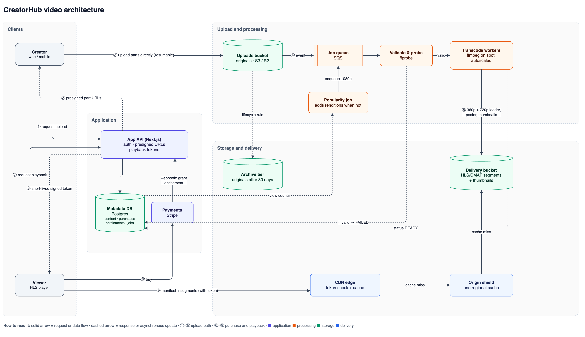

# CreatorHub Studio: Creator Portal

The first version of the CreatorHub creator portal. Creators sign in,
track revenue and sales, upload and manage paid videos, and complete
identity verification, which unlocks publishing.

```bash
npm install && npm run setup && npm run dev   # then open http://localhost:3000
```

Demo password for both accounts: **`creatorhub-demo-2026`**
(`amara@example.com` is verified, `jordan@example.com` is not). Full
instructions are in [14. Deliverables](#14-deliverables).



<sub>Editable source: [`docs/architecture.drawio`](docs/architecture.drawio) (open in draw.io). Mermaid version and the paid-playback sequence: [`docs/ARCHITECTURE.md`](docs/ARCHITECTURE.md).</sub>

This README follows the numbering of the assessment brief, so each
section answers the matching section of the brief.

| # | Brief section | # | Brief section |
|---|---|---|---|
| 1 | [The project](#1-the-project) | 8 | [Part Five: Upload, processing and streaming architecture](#8-part-five-content-upload-processing-and-streaming-architecture) |
| 2 | [Time limit: status and priorities](#2-time-limit-project-status) | 9 | [Architecture diagram](#9-architecture-diagram) |
| 3 | [Technology](#3-technology) | 10 | [Scale and cost challenge](#10-scale-and-cost-challenge) |
| 4 | [Part One: Creator dashboard](#4-part-one-creator-dashboard) | 11 | [Part Six: Product challenge](#11-part-six-product-challenge) |
| 5 | [Part Two: Create and publish content](#5-part-two-create-and-publish-content) | 12 | [Engineering judgment](#12-engineering-judgment) |
| 6 | [Part Three: Account verification](#6-part-three-account-verification) | 13 | [AI usage](#13-ai-usage) |
| 7 | [Part Four: Real-world application states](#7-part-four-real-world-application-states) | 14 | [Deliverables: setup, demo, data, time](#14-deliverables) |

---

## 1. The project

A working Creator Portal with a lightweight real backend instead of mock
endpoints: Next.js route handlers over a service layer, with Prisma and
SQLite, so data persists and the publishing rule is enforced on the
server.

- Creators **register and sign in**, see a **dashboard** of revenue, content
  and purchases, **upload and manage** paid videos, and **verify their
  identity**.
- **Unverified creators can do everything except publish.** The backend
  refuses, and the UI turns that refusal into a clear next step.
- Seeded videos **play** in a YouTube-style player (real Creative Commons
  films; see [14.4](#144-seed-data-reset-and-persistence)).
- The **video platform design** (Parts 5, 9 and 10) is in
  [`docs/ARCHITECTURE.md`](docs/ARCHITECTURE.md), summarised in sections
  8–10 below.

---

## 2. Time limit: project status

**Completed:** every feature in Parts One to Four, plus authentication,
theming, a researched verification flow and a playable video page; the
written design for Part Five, the diagram and the scale and cost
challenge; the product challenge (one recommendation implemented); the
engineering judgment answers; and the AI usage notes.

**What remains, what I'd prioritise next, and why:**

| Priority | Item | Why it comes first |
|---|---|---|
| 1 | Real uploads to object storage (presigned multipart) | Upload is the core creator job and the biggest gap between the demo and production. Everything downstream (processing, playback) depends on it. |
| 2 | Earnings and payouts view | Money is why creators are here; "when do I get paid?" is the question totals don't answer. |
| 3 | Screen-reader audit, plus Playwright tests in CI | The flows are tested by script, but not yet with VoiceOver or NVDA, and CI should stop regressions in the publish gate and verification. |
| 4 | Email verification and password reset | Needed before real accounts hold real money. |
| 5 | Server-side library pagination | Only matters once creators have hundreds of videos; purchases already paginate on the server. |

---

## 3. Technology

Required stack: **React 19, Next.js 16 (App Router), TypeScript, Tailwind
CSS v4, Git.** Additional choices:

| Choice | Why | Trade-off |
|---|---|---|
| **Next.js App Router** (required) | Server components let pages load data directly from the service layer; route handlers give the brief's backend endpoint in the same project. | A newer mental model (server/client boundary), and v16 renamed several APIs. |
| **Prisma + SQLite** | A real relational schema and migrations with zero setup for reviewers; switching to Postgres is a one-line provider change. | SQLite has a single writer; fine for a demo, not for production. |
| **TanStack Query** | Caching, background refetch, retry with backoff, optimistic updates and invalidation, with server prefetch + hydration so the first paint still has data. | One more concept; it's used deliberately for all client reads and writes rather than mixed with ad-hoc fetches. |
| **React Aria Components** | Accessible select, combobox, date picker and calendar (keyboard, screen readers, i18n), unstyled so they match the design. | Larger than native inputs, but native date and select controls can't be styled or searched. |
| **Zod** | One set of rules validates forms in the browser and requests on the server. | None significant. |
| **Own session auth** (scrypt + hashed DB sessions) | No extra dependency, instant revocation, and every security decision is visible and explainable. | Missing extras a library would bring (OAuth, password reset); listed in section 2. |
| **Tailwind v4 with design tokens** | Semantic colour tokens give light and dark themes from one block. | Long class strings, kept manageable with small shared components. |
| **Recharts** | Responsive, accessible-enough charts with little code; paired with a data-table view. | A larger bundle than a hand-drawn SVG. |
| **Vitest** | Fast unit tests against a throwaway SQLite database. | No browser tests in CI yet (checked with Playwright scripts locally). |

**The backend endpoint that enforces the publishing rule:**
`POST /api/content/:id/publish` returns `403 NOT_VERIFIED` for an
unverified creator. The same rule also guards create, edit and scheduled
release (see [section 6](#6-part-three-account-verification)).

---

## 4. Part One: Creator dashboard

| Brief requirement | What's built | Where |
|---|---|---|
| **Overview:** Total Revenue, Revenue This Month, Total Content, Total Purchases | Four stat cards; "this month" shows the change against last month | `features/dashboard/components/OverviewStats.tsx` |
| **Chart** of revenue or purchases over time | 30-day chart with a Revenue / Purchases toggle, zero-filled days, and a "View as table" alternative for screen readers | `features/dashboard/components/PerformanceChart.tsx` |
| **Content** with thumbnail, title, price, views, purchases, revenue, status | Library table (cards on mobile) | `features/content/*` |
| **Statuses:** Published, Draft, Scheduled | All three, with the scheduled date shown | `ContentStatusBadge.tsx` |
| **Actions:** View, Edit, Delete | View (`/content/[id]`, with a playable video), Edit (`/content/[id]/edit`), Delete (with confirmation), plus Publish on drafts | `features/content/*` |
| **Recent purchases:** date, content, amount, country, status | Table with country flags and status badges | `features/purchases/*` |
| **At least two of:** search, filtering, sorting, pagination | **All four** on the content library; **filtering, sorting and pagination on the server** for purchases (`GET /api/purchases`) | `features/content/lib/library-query.ts`, `server/purchases.ts` |

---

## 5. Part Two: Create and publish content

| Brief requirement | What's built |
|---|---|
| Title, description, price, thumbnail, video, publication status | All fields; status is **Draft**, **Publish now** or **Schedule** (with a date and time picker). |
| Form validation | Shared Zod rules in the browser and on the server; inline, announced errors; focus moves to the first invalid field. |
| Error handling | Server errors appear above the form and the input is kept. A refused publish (unverified) opens a dialog instead of failing silently. |
| Success feedback | A toast, then navigation to the new content. |
| Upload / progress experience | **The upload starts as soon as the file is picked**, so it runs while the creator fills in the details. A progress bar with a percentage, and Cancel. A file named with `fail` stops at 60% to demonstrate **Resume upload**, which continues from the last part. |

The media file isn't stored, as the brief allows: the upload is
simulated, and thumbnails are resized in the browser. Code:
`features/content/components/form/*`, `features/content/hooks/use-content-form.ts`.

---

## 6. Part Three: Account verification

### 6.1 The rule: an unverified creator cannot publish

- **Enforced by the backend, in one place.** `server/publishing-policy.ts`
  is the single home of the rule. Every path that can make content public
  calls it: create, edit, the publish endpoint, and the moment scheduled
  content goes live. Each path has a unit test.
- **Unverified creators can still register, use the dashboard and create
  drafts**, exactly as the brief describes.

### 6.2 What happens when an unverified creator tries to publish

- A **banner** across the app explains that publishing needs verification
  and links to it.
- Pressing **Publish** (or saving with "Publish now" or "Schedule") gets
  `403 NOT_VERIFIED` from the server. A dialog explains why and offers
  **Save as draft** or **Save draft & verify**, so no work is lost.
- While verification is **in review**, the message says so ("You can
  publish as soon as it's approved") instead of asking them to verify
  again.

### 6.3 The verification process (steps 1–4)

| Brief step | What's built |
|---|---|
| **Step 1: Personal information** | Legal name (prefilled from the account), date of birth (typed day / month / year segments) and a searchable country list. |
| **Step 2: Identity document** | Choose passport, driver's licence or national ID; capture with the camera or upload. Two-sided documents ask for both sides. On-device checks warn about dark, glary or blurry photos. |
| **Step 3: Identity check** | A selfie with an oval guide and a countdown, or an upload. |
| **Step 4: Confirmation** | A review screen, then a submitted state with a timeline. The simulated review approves (or rejects with a specific reason) about 6 seconds later, and the page updates by itself. |

The server enforces step order, so a step can't be skipped by calling the
API directly. Code: `features/verification/*`, `server/verification.ts`.

### 6.4 Design decisions, from verification drop-off research

Verification is where creator platforms lose people, so I researched it
first ([sources](#research-sources-verification-ux)).

| Research finding | What the flow does |
|---|---|
| Show the step count and time up front; explain why sensitive data is needed | An **intro screen** lists what you'll need, says it takes about 3 minutes, explains why (payouts, buyer trust) and how photos are handled. Nothing is asked for until "Start". |
| Don't fire the camera permission prompt unannounced | The camera starts only when the creator taps **Turn on camera**. Denied, missing or failed cameras each get a clear message and an **upload** fallback. |
| Re-uploading after a failed review is the biggest drop-off point | **On-device quality checks** (brightness, glare, sharpness via variance of the Laplacian) run the moment a photo is taken, each with a specific fix ("Too dark. Move somewhere brighter."). **Use this photo anyway** is always allowed, so a false alarm never blocks anyone. |
| Guide the capture | A live viewfinder with a **card-shaped frame** (rear camera) or an **oval** with a 3-second countdown (front camera, mirrored), with framing instructions on screen. |
| Specific rejection reasons; fix only what failed | A rejection says what was wrong and reopens **only** the step that fixes it. Everything else is kept, and the flow goes straight back to review. |
| Separate "in review" from "rejected"; prevent duplicate submissions | An in-review timeline updates itself (polling), with "no need to resubmit". |
| Save progress | Each step saves on Continue; **Finish later** is always available, and returning creators resume where they left off. |
| Memorable dates shouldn't use calendars (GOV.UK pattern) | Date of birth uses **typed day/month/year segments** in the viewer's locale order, not a calendar. |
| Fewer fields, fewer mismatches | The legal name is **prefilled** from the account; the country is a **searchable** list of every ISO country, with flags and accent-insensitive search. Driver's licences and national IDs ask for both sides; passports only the photo page. |

---

## 7. Part Four: Real-world application states

### 7.1 States

| Brief state | Implementation |
|---|---|
| **Loading** | Skeletons that mirror the real layout. The purchases table keeps the current page visible (dimmed) while the next loads. Buttons show spinners and `aria-busy`. |
| **Empty** | Every list and the chart explain why they're empty and offer one next step; "no results" is a separate state with "Clear filters". |
| **Error** | `QueryView` shows an error panel with **Try again** (progress shown while retrying). Route boundaries use Next 16's `retry()`; `global-error.tsx` covers the root. Forms keep the user's input. Network and 5xx errors retry automatically with backoff first; an offline banner explains connection problems. |
| **Form validation** | Shared Zod rules, inline and announced; focus moves to the first invalid field. |
| **Successful actions** | Toasts (polite live region, following the theme) plus navigation to the result. |
| **Confirmation before destructive actions** | Native `<dialog>` confirmation with focus starting on **Cancel**; the message explains that purchase history is kept. |

### 7.2 Desktop, tablet and mobile

- A sidebar on desktop, and a **bottom tab bar** on mobile.
- Tables become **cards** below `md`.
- **44px touch targets**, and 16px inputs so iOS doesn't zoom.
- The camera picks the rear or front lens as appropriate.
- The video player has touch behaviour (first tap shows the controls),
  and its menus fit small screens.
- Every key flow was checked by script at **390px wide**.

### 7.3 Accessibility

- **Structure:** landmarks, a skip link, one `h1` per page, `aria-current`
  in navigation, table captions and header scopes.
- **Controls:**
  - Dropdowns, comboboxes, date fields, the calendar and the theme switch
    are React Aria components, with full keyboard support (arrows,
    typeahead, Home/End, Escape) and correct ARIA roles.
  - Dialogs use native `<dialog>`, with focus containment and focus
    returned to the trigger.
  - Choice cards are native radio groups.
  - The video player's seek bar is a keyboard slider, and it supports
    YouTube's shortcuts (k/space, j/l, arrows, m, f, 0–9).
- **Forms:** labels, hints and errors are linked via `aria-describedby` and
  `aria-invalid`, and errors are announced. Passwords have a show/hide
  toggle (`aria-pressed`) and a live requirements checklist.
- **Verification:**
  - the stepper is an ordered list with `aria-current="step"`, and step
    changes are announced, with focus moving to the step heading;
  - capture state, quality results and the selfie countdown are announced
    through a live region;
  - the camera is never the only option: upload is always available.
- **Perception:**
  - status always pairs colour with an icon and text;
  - WCAG AA contrast in both themes;
  - the chart colour was validated for each theme;
  - `prefers-reduced-motion` is respected.

Checked with `eslint-plugin-jsx-a11y` and scripted Playwright runs of
every key flow at 390px wide (including a fake camera). A manual
screen-reader audit is still on the next-steps list.

---

## 8. Part Five: Content upload, processing and streaming architecture

The full design is in [`docs/ARCHITECTURE.md`](docs/ARCHITECTURE.md). In
short, for **Creator Upload → Processing → Storage → Delivery → Playback**:

### 8A. Upload ([full answer](docs/ARCHITECTURE.md#a-upload))

- **Multipart, resumable uploads straight to object storage** with
  presigned part URLs: parts of 8–16 MB (5 MB on mobile), 3–4 in parallel.
- **Slow or interrupted connections** cost one part, not the whole file;
  the client resumes from the next missing part. Abandoned uploads are
  deleted after 7 days.
- **Progress** comes from bytes confirmed per part. Files are **validated**
  before upload (type, size) and again after (`ffprobe`).
- **Mobile:** the upload starts when the file is picked (implemented).
- **Should large files pass through the main application server? No.** It
  would tie up app instances for minutes per upload, double the bandwidth
  bill, and make the API's availability depend on upload traffic. The API
  only signs URLs.

### 8B. Processing ([full answer](docs/ARCHITECTURE.md#b-processing))

- An object-created event goes onto a **queue**; workers validate and probe
  the file **before any transcoding spend**, extract metadata, generate a
  poster, thumbnails and a seek sprite, then transcode.
- **Base ladder only:** 360p and 720p H.264 as CMAF segments, one set
  serving both HLS and DASH, so it plays on every device and network speed.
- **Avoiding unnecessary cost:** never upscale, remux instead of
  re-encoding when possible, deduplicate identical uploads, run on spot
  workers, and add higher renditions only when a video earns them (8F).

### 8C. Storage ([full answer](docs/ARCHITECTURE.md#c-storage))

| Data | Where | Why |
|---|---|---|
| Original video | Object storage, moved to infrequent-access and then archive tiers | Needed only to re-transcode, which is rare |
| Processed video | Object storage (standard), behind the CDN | Immutable, versioned paths allow year-long caching |
| Thumbnails | Object storage behind the CDN | Small, heavily read, immutable |
| Metadata | Postgres | Relational and transactional: a purchase and its access must be consistent |

Cloudflare R2 (free egress) or S3 with CloudFront; the pattern is the same.

### 8D. Streaming and content delivery ([full answer](docs/ARCHITECTURE.md#d-streaming-and-delivery))

- **CDN with an origin shield**, so each segment leaves storage about once
  per region.
- **Adaptive bitrate (HLS/DASH)** for different network conditions;
  **fast start** (low first rendition, short first segments, poster
  shown immediately); **seeking** fetches exactly one segment.
- Segments are immutable with **one-year cache TTLs**; popular videos stay
  hot at the edge, and the long tail is served from the shield. The CDN's
  global presence handles different countries.

### 8E. Paid content protection ([full answer](docs/ARCHITECTURE.md#e-paid-content-protection))

The API checks the buyer's **entitlement**, then returns a **short-lived
signed token** (about 10 minutes) scoped to that video's path and tied to
the user. A **CDN edge function** checks the signature, expiry and path on
every request, so a copied URL stops working within minutes. The token
isn't part of the cache key, so caching still works. DRM isn't needed now,
as the brief says.

### 8F. Cost efficiency ([full answer](docs/ARCHITECTURE.md#f-cost-efficiency-should-5-views-and-500000-views-be-treated-the-same))

**Should a video with 5 views be treated the same as one with 500,000? No.**
Most videos get very few views, and spending the same on both wastes
money on the long tail:

| Tier | Trigger | What we do |
|---|---|---|
| Every upload | Always | Validate, then the cheap base ladder (360p + 720p) |
| Warm | e.g. > 1,000 views in 7 days | Add 1080p |
| Hot | e.g. > 50,000 views in 7 days | Add AV1/HEVC (costly to encode, but 30–50% less bandwidth, which only pays off at high view counts) |
| Cold | No views in 90 days | Move files to cheaper storage tiers |

Other savings: free storage-to-CDN egress, long cache TTLs (so repeated
requests never reach storage), one CMAF set for HLS and DASH, lifecycle
rules, and spot workers.

---

## 9. Architecture diagram

The diagram at the top of this README shows the major components and the
numbered path of one video: upload (①–⑤), then purchase and playback
(⑥–⑨).

- **Image:** [`docs/architecture.png`](docs/architecture.png)
- **Editable source:** [`docs/architecture.drawio`](docs/architecture.drawio) (draw.io)
- **Mermaid version**, plus a **paid-playback sequence diagram**:
  [`docs/ARCHITECTURE.md`](docs/ARCHITECTURE.md#system-diagram)

---

## 10. Scale and cost challenge

Assumptions: 100,000 creators, 1 million videos, 10 million views a month,
viewers in many countries. Full answer:
[`docs/ARCHITECTURE.md`, "Scale and cost challenge"](docs/ARCHITECTURE.md#scale-and-cost-challenge).

1. **What scales easily?** Object storage and the CDN (managed and global),
   transcoding (queue-driven, add workers), and the stateless API (more
   copies behind a load balancer; video bytes never pass through it).
2. **Likely bottlenecks?** Postgres (dashboard aggregates and hot counters,
   fixed with rollups, read replicas and an analytics pipeline), upload
   bursts after viral events, and playback token issuance on every play.
3. **What gets expensive?** **CDN bandwidth, by far**, then transcoding and
   storage.
4. **What would I monitor?** Upload success and resume rates, queue age and
   job failures, cache hit ratio and origin egress, video start time and
   rebuffering, and purchase-to-playback success.
5. **What would I change as traffic grows?** Demand-tiered renditions,
   committed-use or multi-CDN pricing, an OLAP store for analytics,
   per-title encoding, and a second origin region only if the metrics show
   slow starts far away.

**Rough monthly cost estimate** (list prices; the reasoning matters more
than the total):

| Item | Assumption | Estimate / month |
|---|---|---|
| **CDN bandwidth** | 10M views × 8 min × ~2 Mbps ≈ 120 MB per view ≈ **1.2 PB** | **~$40k** at list price; $10–25k with committed pricing |
| CDN requests and edge auth | ~800M segment requests | ~$1k |
| Storage | ~250 TB of renditions + ~750 TB of originals, mostly in cold tiers | ~$5–9k |
| Transcoding | ~50k new videos a month on spot workers | ~$1–2k |
| Compute, database, queue and monitoring | Autoscaled containers, managed Postgres | ~$3–6k |
| **Total** | | **~$50–60k at list price; ~$25–35k optimised** |

**Largest cost as the platform scales: CDN bandwidth.** It grows with
every view and minute watched, so the main levers are bandwidth levers:
better codecs for hot videos, the right default bitrate, cache hit ratio
and CDN pricing.

---

## 11. Part Six: Product challenge

| # | What I'd change | Why | How it improves the creator experience | Priority |
|---|---|---|---|---|
| 1 | **Background upload that starts when the file is picked**, plus resume after a lost connection *(implemented)* | Large mobile uploads are the riskiest step; waiting for a form first wastes minutes | Time-to-publish shrinks to typing time; a dropped connection doesn't mean starting over | High |
| 2 | **"Ready to earn" checklist** on first login: verify → add a payout method → upload → publish *(not requested in the brief)* | Creators should meet verification before the publish gate, not at it | A clear path to a first sale; fewer blocked publishes; higher activation | High |
| 3 | **Earnings and payouts view**: pending vs available balance, fees, next payout date, export *(not requested in the brief)* | Totals don't answer "when do I get paid?" | Trust and transparency; fewer support tickets | Medium |

Other product decisions I made beyond the brief:

- **Scheduling counts as publishing**, so it needs verification too; the
  rule is checked again when scheduled items go live.
- **Delete is a soft delete**, so buyers' purchase history and earnings
  survive.
- **Blocked publishing never loses work**: "Save draft & verify".
- **Another creator's content returns 404, not 403**, so content ids can't
  be probed for existence.

---

## 12. Engineering judgment

### Architecture: why this structure?

```
src/
├── proxy.ts             Optimistic auth redirect (cookie present?), no database access
├── app/
│   ├── (auth)/          /login, /register: split-screen layout, no app shell
│   ├── (studio)/        Signed-in pages; the layout calls requireCreator() and prefetches the creator
│   └── api/             Route handlers; _lib/handle-route.ts maps domain errors to HTTP
├── server/              Business logic and data access (framework-agnostic, unit-tested)
│   ├── auth/            scrypt passwords, hashed session tokens, rate limiter, accounts
│   ├── session.ts       The only module that reads/writes the session cookie
│   ├── publishing-policy.ts   The single home of "unverified can't publish"
│   ├── prefetch.ts      Server-side query definitions, using the same keys as the client
│   └── content / purchases / analytics / verification / mappers
├── features/<domain>/   api.ts (fetchers) · queries.ts (React Query options) · hooks · components
├── components/ui/       Accessible primitives: Select, ComboBox, date fields, Dialog, VideoPlayer, …
├── components/layout/   App shell, navigation, account menu, theme toggle, banners
└── lib/                 Zod schemas, API contract and client, query keys and client, formatting
```

- **Thin routes over a framework-free service layer.** The business rules
  can be tested without a server, and the critical rule lives in one file.
- **Data flow: server prefetch, then React Query.**
  - Each page prefetches its queries in parallel, straight from the service
    layer with no HTTP round trip, and dehydrates them into a
    `<HydrationBoundary>`. The first paint has all the data.
  - From then on, client components read with `useQuery` against the same
    keys (`lib/query/keys.ts`), so the browser cache, background refetch,
    retry and invalidation all apply.
  - Writes are mutations: publish and delete update optimistically and roll
    back on error, and every write invalidates the content and dashboard
    queries.
  - Publishing is optimistic **only** for verified creators; otherwise the
    server will refuse, and showing "Published" first would be a lie.
- **Auth is layered.** `proxy.ts` redirects requests without a cookie
  before anything renders. `requireCreator()` / `requireApiCreator()` check
  the session in the database on every page and API call. Services take
  the acting creator as an argument and never read cookies.
- **One contract on both sides.** The same Zod schemas validate in the
  browser and on the server. The error envelope `{ error: { code,
  message, fieldErrors } }` is typed once and produced in one place.
- **Accessible primitives instead of per-feature markup**, built on React
  Aria; the app's code only styles them.
- **Theming with tokens.** Colours are semantic CSS variables switched by
  `data-theme` (next-themes), applied before first paint.

### Scale: what would change at millions of users?

- Postgres with read replicas.
- Pre-aggregated dashboard metrics (daily rollups or an OLAP store).
- Server-side pagination for the library, as purchases already have.
- Redis for sessions, entitlements and rate limits.
- Scheduled releases and view counts moved to queues and cron jobs.
- The video side is covered in sections 8–10.

### Security: what before production?

**Already implemented:**
- Passwords hashed with scrypt, using a per-password salt and parameters
  stored with the hash.
- Session tokens are 256-bit random values stored only as SHA-256 hashes,
  so they can be revoked instantly.
- Cookies are `httpOnly`, `sameSite=lax`, and `secure` in production.
- Login and registration are rate limited; login answers with one generic
  error, and unknown emails take as long as wrong passwords, so emails
  can't be enumerated.
- `next` redirects are restricted to the same site (no open redirect).
- Every query is scoped to the acting creator.

**Before production:**
- the rate limiter in Redis (it's per-instance in memory today);
- CSRF tokens on mutations, in addition to `sameSite`;
- email verification and password reset;
- a strict Content Security Policy;
- a real identity vendor, with personal data encrypted at rest and
  retention limits;
- presigned uploads with server-side content sniffing and malware scanning;
- signed playback tokens;
- audit logs;
- dependency scanning.

### Performance: keeping the frontend fast

- Server-rendered first paint from the prefetched cache.
- `staleTime` stops hydrated data from being refetched immediately.
- Per-query caching makes revisits instant.
- Client JavaScript only where interaction needs it.
- `next/image` for thumbnails; the video player loads only metadata until
  the viewer presses play.
- Next: a bundle budget in CI, real-user Core Web Vitals, and lazy-loading
  the chart and capture code.

### Reliability: what happens when a service fails?

| Failure | Behaviour |
|---|---|
| Upload interrupted | Multipart parts are kept; the client resumes from the last completed part (simulated here). Incomplete uploads expire after 7 days. |
| Video processing fails | Retries with backoff, then a dead-letter queue. The creator sees `FAILED` and "Retry processing"; the original is kept. |
| CDN unavailable | Multi-CDN failover via DNS health checks, plus a fallback host in the player. The demo player already recovers from a stalled stream by reloading the source and resuming at the same position. |
| API unavailable | Cached data stays on screen, with automatic and then manual retry. Forms keep their input. An offline banner explains connectivity problems. |
| Payment succeeds but video authorization fails | The payment webhook is the source of truth and grants the entitlement idempotently. The player retries token issuance; if it still fails, the viewer sees "Purchase confirmed, preparing access", reconciliation repairs it, and support is alerted. |

### Observability: what would I monitor?

- Structured logs with request IDs and error digests.
- Error tracking on client and server.
- Golden signals per route.
- Funnels: sign-up → verified → first publish; verification drop-off per
  step, quality-warning rate and rejection rate; upload → ready →
  published; purchase → playback.
- Video quality of experience.
- Alerts on queue age, cache hit ratio, login failure spikes and token
  rejections.

### Next steps: another week on the product

I'd start with **real presigned multipart uploads to object storage**:
upload is the core creator job, and processing and playback depend on
it. Then the **earnings and payouts view**, because payouts are why
creators use the platform. The full ordered list, with reasons, is in
[section 2](#2-time-limit-project-status).

---

## 13. AI usage

[`AI-USAGE.md`](AI-USAGE.md) answers each question in the brief:

1. Which AI tools did I use?
2. What did I use them for?
3. Where did AI save the most time?
4. One example where AI output was rejected, corrected or significantly
   changed.
5. How did I verify AI-generated code?
6. What did I deliberately do myself, and why?

---

## 14. Deliverables

### 14.1 Setup and run

Requires Node 20+.

```bash
npm install        # also generates the Prisma client
npm run setup      # creates prisma/dev.db and seeds demo data
npm run dev        # http://localhost:3000, which redirects to /login
```

| Command | What it does |
|---|---|
| `npm test` | Vitest suite: publishing rule, auth (hashing, sessions, rate limiting), verification (ordering, rejection, resubmission), photo quality checks, library query logic. Uses a separate `prisma/test.db`. |
| `npm run lint` / `npm run typecheck` | ESLint (including jsx-a11y and React Compiler rules) / TypeScript |
| `npm run db:reset` | Drops and recreates the database, then re-seeds it |
| `npm run build && npm start` | Production build |

### 14.2 Demo accounts

Both accounts use the password **`creatorhub-demo-2026`**. The login page
also has one-click **Sign in** buttons for them.

| Account | State |
|---|---|
| `amara@example.com` | Verified. 12 videos (published, scheduled, draft) and 40 purchases across every status. |
| `jordan@example.com` | Not verified. Drafts only and no sales: the publish gate, verification and empty states. |

You can also **create your own account** at `/register`. New accounts
start unverified with an empty library.

### 14.3 Demo-state controls

**Reset demo data** is in the account menu (click your name in the sidebar,
or your avatar on mobile). It restores the seed and signs everyone out.

| To see | Do this |
|---|---|
| **Auth gate** | Open any page while signed out: you're redirected to `/login?next=…` and returned there after signing in. |
| **Publish gate** | As Jordan, press **Publish** on a draft, or upload a video with "Publish now". The server returns `403 NOT_VERIFIED`; a dialog offers "Save as draft" or "Save draft & verify". |
| **Verification, approved** | As Jordan, open **Verify** and complete the steps with clear photos (camera or upload). About 6 seconds after you submit, the review approves and the page, banner and account badge update by themselves. |
| **Verification, rejected and fixed** | Upload a **dark or blurry** ID photo, choose "Use this photo anyway", and submit. The review rejects it with a specific reason; the wizard reopens at **only** the document step, then jumps straight back to review. |
| **Video playback** | Open any seeded video (the eye icon or its title). The player supports YouTube's keyboard shortcuts: k or space, j/l, arrows, m, f, 0–9. |
| **Upload failure and resume** | Upload a video whose file name contains `fail`. It stops at about 60%; **Resume upload** continues from the last part. |
| **Error and retry** | Stop the server, then change the purchases page: automatic retries, then **Try again**. Go offline in DevTools for the offline banner. |
| **Theming** | Account menu → Light / Dark / System. Saved per browser, with no flash of the wrong theme on reload. |

**Publish gate via curl:**
```bash
curl -c jar -H 'Content-Type: application/json' \
  -d '{"email":"jordan@example.com","password":"creatorhub-demo-2026"}' localhost:3000/api/auth/login
ID=$(curl -s -b jar localhost:3000/api/content | node -pe 'JSON.parse(require("fs").readFileSync(0)).items[0].id')
curl -i -b jar -X POST localhost:3000/api/content/$ID/publish     # 403 NOT_VERIFIED
```

### 14.4 Seed data, reset and persistence

**Seed data** (synthetic; the brief asks for at least 12 content and 20
purchase records):
- 2 creators;
- **14 content items**: Published, Scheduled and Draft;
- **40 purchases**: Completed, Pending, Refunded and Failed, from 12
  countries.

**Demo videos.** Every seeded item plays a real film on its content page:
Blender open movies (Big Buck Bunny, Sintel, Tears of Steel, Spring, Sprite
Fright and others) streamed from Wikimedia Commons under Creative Commons
licences (CC BY 2.5–4.0, one CC BY-SA 3.0). Each page credits its film and
links to the source. The films are placeholders and don't match the
seeded titles. New uploads are simulated, so they show a poster with
"Preview unavailable" instead of a player.

**Reset:** **Reset demo data** in the account menu, or `npm run db:reset`.

**Persistence:** SQLite at `prisma/dev.db`. Data **survives page refreshes
and server restarts**; only a reset restores the seed. The seed is
deterministic (seeded random numbers, dates relative to today), so every
reset looks the same and recent.

### 14.5 Assumptions and limitations

- **Identity checks are simulated.** Photos never leave the browser; only
  file names are saved. The quality checks are real; the review decision is
  simulated about 6 seconds after submission (rejected if a flagged ID
  photo was kept).
- **Media isn't stored.** The upload is simulated; thumbnails are resized
  to 640×360 in the browser and stored as data URLs.
- **USD only.** Date entry follows the browser's locale; other dates
  display in `en-US`.
- **Scheduled content** is released when the creator's pages next load, not
  by a background job.
- **Rate limits are in memory**, so they apply per server instance.
- **Not-found pages under a `loading.tsx` return HTTP 200**, because
  streaming has already started. This is documented Next.js behaviour; the
  page carries `noindex`.
- **Demo videos are WebM**, which plays in current Chrome, Firefox, Edge and
  Safari, but not on iPhones older than iOS 17.4.

### 14.6 Approximate time spent

Approximately **50 hours** in total.

### 14.7 Parts I implemented myself

**The identity verification flow** (`features/verification/*`, `server/verification.ts`).

I chose to build it myself because verification is where creator platforms lose the most people, so it needed the most care.

- Flow and state: four steps (personal info → ID document → selfie → review), saved on each Continue so creators can finish later and resume. The server enforces the step order, so a step can't be skipped by calling the API directly.

- User-friendliness: an intro screen that sets expectations; date of birth as typed day/month/year fields instead of a calendar; a searchable country list; the legal name prefilled; on-device photo checks for darkness, glare and blur, each with a specific fix; a rejection reopens only the step that failed.

- Accessibility: the stepper uses aria-current="step"; step changes and photo-check results are announced to screen readers; focus moves to each new step's heading; upload is always an alternative to the camera.

- Authentication before upload. Signed-out users are redirected to sign in before they can reach the upload page (proxy.ts), and every page and API call checks the session in the database (requireCreator() / requireApiCreator()). So an upload is always tied to a real, signed-in creator.

### Research sources (verification UX)

- KYC drop-off and UX practices: [KYCAID](https://kycaid.com/blog/reduce-user-drop-off-kyc-verification-ux/), [Shufti Pro](https://shuftipro.com/blog/reduce-kyc-drop-off-ux-fixes/), [Zyphe](https://www.zyphe.com/resources/blog/reduce-kyc-onboarding-drop-off)
- Document capture guidance: [Stripe support](https://support.stripe.com/questions/uploading-photo-of-government-issued-id-faq), [Incode ID capture design](https://devhub.omnihub.incode.com/design-and-ux/id-capture-design.md), [Microblink](https://microblink.com/?p=4657)
- Selfie and liveness UX: [Veridas recommendations](https://docs.veridas.com/sap-sdk/ios-swift/v1.2/configuration/recommendations/), [Yoti](https://developers.yoti.com/identity-profiles/liveness)
- Retry and rejection states: [Persona help](https://help.withpersona.com/for-users/), [Xsolla creator payouts](https://developers.xsolla.com/creators/payouts-cc/)
- Wizard accessibility: [Trimble Modus](https://modus.trimble.com/components/web/wizard/accessibility), [Ezud](https://ezud.com/accessible-multi-step-wizard-forms/)
