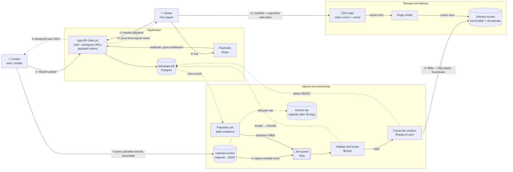
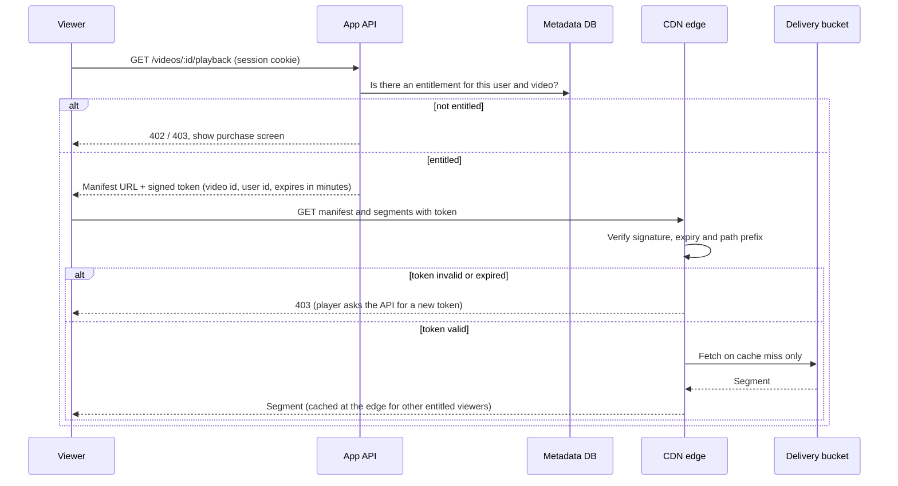

# CreatorHub Video Architecture

How a video gets from a creator's device to a paying viewer:
**Creator Upload → Processing → Storage → Delivery → Playback**.

Components are named generically, with an example service in brackets. The
design depends on the pattern, not on one vendor.

The diagram above is exported from [`architecture.drawio`](architecture.drawio)
(open it in draw.io to edit). The Mermaid version below renders directly on
GitHub.

## System diagram

Numbered steps follow one video from upload to playback.

## Paid playback sequence

How a shared link stops working for someone who did not pay.

## What the diagram shows

- **Large files never pass through the app server.** The API only issues
  presigned multipart URLs. The upload goes straight from the device to the
  bucket in independently retried parts, so a dropped connection costs one
  part rather than the whole file.
- **Processing is event-driven and asynchronous.** The bucket emits an
  event, a queue absorbs bursts, and workers scale with queue depth. Spot
  capacity is safe here because a failed job is simply retried.
- **Validation runs before transcoding.** Corrupt, unsupported or oversized
  files fail cheaply at the `ffprobe` step, before any transcoding spend.
- **Transcoding is tiered by demand.** Every video gets a small base ladder
  (360p and 720p). Higher renditions are added only when the popularity job
  sees real demand, so a video with 5 views costs far less than one with
  500,000.
- **Storage is split by access pattern.** Originals go to an archive tier
  after 30 days and can be re-transcoded from there. Delivery segments stay
  in standard storage behind the CDN. Metadata lives in Postgres, never in
  object storage.
- **Every request is authorized at the edge.** Segment URLs are useless
  without a short-lived token tied to the user, the video and an expiry
  time, so copying a URL does not grant lasting access. Edge caching still
  works because the token is checked before the cache lookup and is not
  part of the cache key.
- **An origin shield protects the bucket.** Each segment is fetched from
  storage roughly once per region and served from cache afterwards. This
  cuts origin egress and request costs.

---

## A. Upload

**Large files never pass through the application server.** Routing
gigabytes through the API would tie up app instances for minutes per
upload, double the bandwidth bill (in and then out again to storage), and
make the API's availability depend on upload traffic. The API only does
cheap control-plane work: it authenticates, validates the declared file,
creates the content record and returns presigned URLs.

| Concern | Approach |
|---|---|
| Files from MB to GB | S3/R2 **multipart upload**: parts of 8–16 MB (5 MB on mobile), uploaded 3–4 in parallel with presigned part URLs. |
| Slow connections | Smaller parts on mobile or slow links (measured from the first parts' throughput), so a failed part costs seconds, not minutes. |
| Interrupted uploads | The upload ID and completed part numbers are kept in IndexedDB. On reconnect the client calls `ListParts` and continues from the next missing part. A lifecycle rule aborts incomplete multipart uploads after 7 days, so abandoned parts don't keep costing money. |
| Progress | Computed client-side from bytes acknowledged per part. Shown as a progress bar with a percentage, plus Pause, Resume and Cancel. |
| Validation | **Before upload:** extension, MIME type and size limits (implemented in the demo). **After upload:** `ffprobe` checks the real container and codec, duration, resolution and integrity. The file's declared type is never trusted. |
| Mobile | The upload starts the moment a file is picked, while the creator types the details (implemented). Uploads keep running in the background where the platform allows it, and the screen is kept awake during foreground uploads. |
| Integrity | Each part carries an MD5 or CRC32C checksum; storage rejects corrupted parts. |

## B. Processing

An object-created event goes onto a queue. Workers pull jobs, so traffic
spikes queue up instead of failing. Jobs are idempotent, keyed by
`videoId + rendition`, so retries are safe. A job that keeps failing lands
in a dead-letter queue, and the content is marked `FAILED` in the creator's
UI, with a one-click retry.

1. **Validate and probe** with `ffprobe`. Corrupt, unsupported or oversized
   files are rejected **before any transcoding spend**.
2. **Extract metadata**: duration, resolution, frame rate, audio channels and
   rotation, stored in Postgres.
3. **Generate images**: a poster frame, 3 suggested thumbnails taken at
   keyframes, and a sprite sheet for seek-bar previews.
4. **Transcode a base ladder**: 360p (~0.8 Mbps) and 720p (~2.5 Mbps) H.264/AAC,
   as **CMAF** (fMP4) segments of 4–6 s. One set of segments serves both
   **HLS** (Apple and most players) and **DASH**, so storage isn't duplicated.
5. **Add more renditions only when demand justifies them.** See F.

Cost guards in processing:

- **Never upscale**: the ladder is capped at the source resolution.
- **Remux instead of re-encoding** when the source already matches a target
  rendition (codec, bitrate and keyframe interval within tolerance).
- **Deduplicate**: a content hash of the upload catches identical re-uploads.
- **Spot or preemptible workers**, autoscaled on queue depth (safe because
  jobs are idempotent and retryable).
- **Per-title encoding later**: simple talking-head videos need far fewer
  bits than action footage at the same quality.

## C. Storage

| Data | Where | Why |
|---|---|---|
| Original upload | Object storage, moved by a lifecycle rule to an infrequent-access tier after 30 days and to archive after 180 | It's needed only to re-transcode (new codec, new rendition), which is rare. Keeping it lets us re-encode without asking the creator to upload again. |
| Processed renditions | Object storage, standard tier (intelligent tiering for the long tail) | Read by the CDN origin shield only on a cache miss. Immutable, versioned paths (`/v/{videoId}/{renditionVersion}/…`) allow year-long cache TTLs. |
| Thumbnails and sprites | Object storage behind the CDN | Small, heavily read and immutable, so they are almost always served from the edge. |
| Metadata, purchases, entitlements | **Postgres** | Relational and transactional. A purchase and its entitlement must be consistent, and reporting needs joins and aggregates. Read replicas take the dashboard queries. |

I'd lean towards **Cloudflare R2** or S3 with CloudFront. R2 charges
nothing for egress, which removes the "storage → CDN" bandwidth line
entirely. S3 with CloudFront is similar because S3-to-CloudFront transfer
is free, and it has a more mature transcoding ecosystem. Either way the
pattern is identical.

## D. Streaming and delivery

- **CDN edge caching** with an **origin shield** (one regional cache in
  front of storage), so each segment leaves storage about once per region.
- **Adaptive bitrate (HLS/DASH)**: the player switches renditions per
  segment as bandwidth changes, so a viewer on a slow mobile network gets
  360p instead of buffering.
- **Startup time**:
  - start at a low rendition and step up;
  - keep the first segments short;
  - preconnect to the CDN origin;
  - show the poster frame immediately;
  - prefetch the manifest and first segment when the viewer hovers or opens
    the page.
- **Seeking**: segments start on keyframes, so a seek fetches exactly one
  segment; the thumbnail sprite gives instant previews.
- **Caching policy**: segments are immutable, so their TTL is 1 year. Paid
  manifests are short-lived and never shared-cached across users. The
  authorization token is **not** part of the cache key, so one cached
  segment serves every entitled viewer.
- **Popular vs rarely viewed**: popular segments stay hot at hundreds of
  edge locations. Long-tail content is served from the shield, which still
  avoids most origin reads. Trending videos can be pre-warmed.
- **Multiple countries**: the CDN's global points of presence handle
  geography. A single origin region plus a shield is enough until data
  shows otherwise.

## E. Paid content protection

The goal is that a copied URL is useless to anyone who didn't pay.

1. The viewer asks the API for playback (`GET /videos/:id/playback`) with
   their session.
2. The API checks the **entitlement** (a purchase row created by the
   payment provider's webhook, never by the client).
3. The API returns a **short-lived signed token or cookie**:
   - scoped to the path prefix `/v/{videoId}/*`;
   - containing the user ID and an expiry of about 10 minutes;
   - signed with a key that only the API and the CDN know.
4. A **CDN edge function** checks the signature, expiry and path on every
   manifest and segment request before the cache lookup. An invalid or
   expired token gets 403.
5. The player refreshes the token through the API before it expires, so
   long viewing sessions continue seamlessly.

Extras as the business needs them:

- concurrent-stream limits per user (enforced at token issuance);
- soft binding of tokens to an IP range or network;
- forensic watermarking to trace leaked screen recordings;
- DRM (Widevine/FairPlay) for premium catalogs.

As the brief notes, DRM isn't needed now; signed short-lived URLs stop
casual link sharing at a fraction of the complexity.

## F. Cost efficiency: should 5 views and 500,000 views be treated the same?

**No.** Most videos on creator platforms get very few views, and a small
number get most of the traffic. Spending the same on both wastes money on
the long tail and under-invests in the hits.

| Tier | Trigger | What we do |
|---|---|---|
| Every upload | Always | Validate first, then the base ladder (360p + 720p H.264), poster and sprite. Cheap and plays everywhere. |
| Warm | e.g. > 1,000 views in 7 days | Add 1080p. Higher quality where it's actually watched. |
| Hot | e.g. > 50,000 views in 7 days | Add **AV1/HEVC** renditions. They cost ~10× more compute to encode but cut bandwidth 30–50%, which only pays back at high view counts. Pre-warm edges. |
| Cold | No views in 90 days | Originals already in archive. Renditions move to an infrequent-access tier; the shield absorbs the occasional view. |

A nightly job reads view counts from analytics and enqueues promotion jobs.
The rule is simple: **spend compute only where it will be repaid in
bandwidth saved or experience improved.**

Other savings:

- Free egress between storage and CDN (R2, or S3 to CloudFront), and an
  origin shield.
- Long immutable TTLs, so repeat requests never reach the origin.
- One CMAF set serves both HLS and DASH (no duplicate storage).
- Lifecycle rules on originals and on incomplete multipart uploads.
- Spot workers for transcoding.

---

## Scale and cost challenge

**Assumptions:** 100,000 creators; 1,000,000 stored videos; 10 million views
per month; viewers in many countries.

### What scales easily

- **Object storage and the CDN.** Both are effectively unlimited managed
  services that are already global.
- **Transcoding.** It's queue-driven and stateless, so throughput grows by
  adding spot workers.
- **The stateless app and API tier.** It scales horizontally behind a load
  balancer, and uploads never pass through it.

### Likely bottlenecks

- **Postgres**:
  - dashboard aggregates over large purchase tables. Fix: pre-aggregated
    daily rollups and read replicas.
  - hot rows such as view counters. Fix: count views in an analytics
    pipeline, not with per-view `UPDATE`s.
- **Upload bursts**: many uploads after a viral event. The queue absorbs
  them, but time-to-publish grows; autoscale on queue age, not just depth.
- **Playback token issuance**, one call per viewer start and per refresh.
  It's cheap and stateless, but it's on the critical path. Cache
  entitlements in Redis and keep token signing local, with no database call
  on refresh.

### What gets expensive

**CDN bandwidth, by a wide margin.** Transcoding and storage come next.

### What I'd monitor

| Area | Metrics |
|---|---|
| Upload | Success rate; resume rate; time to "ready"; size and failure reasons by device type |
| Processing | Queue depth and age; job failure rate; dead-letter count; encode cost per minute |
| Delivery | CDN cache hit ratio (edge and shield); origin egress; 4xx/5xx by region |
| Playback | Video startup time (p50/p95); rebuffering ratio; average bitrate delivered; playback failures by device |
| Business | Purchase → playback success; refund rate; token rejections (spikes may signal link sharing or a bug) |

### What I'd change as traffic grows

1. Introduce the demand-tiered renditions as soon as the bandwidth bill is
   meaningful.
2. Negotiate committed-use CDN pricing, or go multi-CDN with traffic
   steering by price and performance per region.
3. Move dashboard analytics to an OLAP store (ClickHouse/BigQuery) fed by
   events.
4. Add per-title encoding.
5. Add a second origin region only if shield-miss latency in far regions
   shows up in startup-time metrics.

### Rough monthly cost estimate

The numbers are approximate list prices; the reasoning matters more than
the totals.

| Item | Assumption | Estimate / month |
|---|---|---|
| **CDN bandwidth** | 10M views × 8 min average watch time × ~2 Mbps blended bitrate ≈ **120 MB/view ≈ 1.2 PB/month** | **~$40k** at blended list price (~$0.035/GB); **$10–25k** with committed pricing or a lower-cost CDN |
| CDN requests and edge authentication | ~80 segment requests per view ≈ 800M requests; an edge function on each | ~$1k |
| Rendition storage | 1M videos × ~250 MB (360p + 720p) ≈ 250 TB, plus hot-tier 1080p | ~$4–6k (R2/S3 standard) |
| Original storage | 1M × ~750 MB ≈ 750 TB, mostly in infrequent-access or archive tiers | ~$1–3k |
| Transcoding | ~50k new videos per month × 10 min = 500k minutes, 2 base renditions on spot ffmpeg (~4× realtime) plus promotions | ~$1–2k (a managed transcoder like MediaConvert would be ~$10k+) |
| App/API compute | A few autoscaled containers | ~$1–2k |
| Postgres | Primary + read replica, managed | ~$1–2k |
| Queue, functions, logging, monitoring | | ~$1–2k |
| **Total** | | **~$50–60k at list price; ~$25–35k optimised** |

**Largest cost as the platform scales: CDN bandwidth.** It grows linearly
with views and watch time, while storage and transcoding grow with uploads.
That's why the main cost levers are bandwidth levers: better codecs for hot
content, the right default bitrate, cache hit ratio and CDN pricing.
